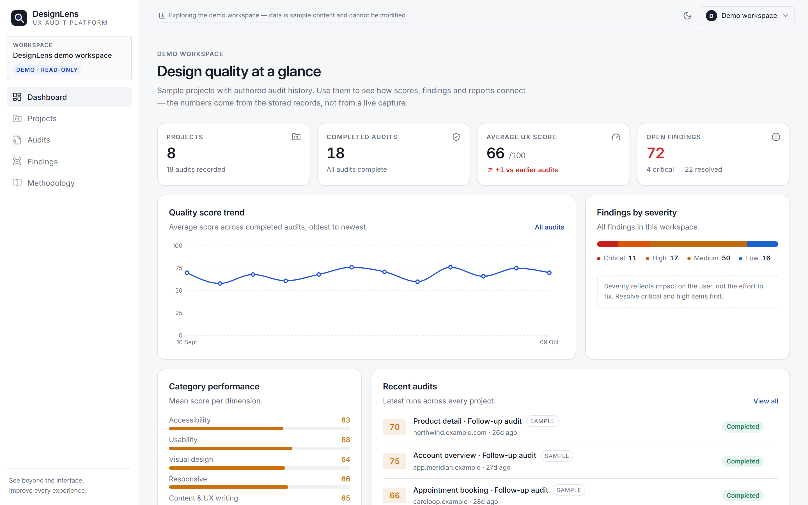

# DesignLens

**See beyond the interface. Improve every experience.**

DesignLens is a universal UX audit platform. Point it at any publicly reachable web page and it measures
seven dimensions of design quality — accessibility, usability, visual design, responsive behaviour,
content, performance and design consistency — then turns the measurements into findings, scores and a
report a team can act on.

It is a standalone product: no third-party identity provider, no proprietary design system, and no
dependency on any internal infrastructure. Projects are industry-agnostic.



---

## What it actually does

The audit engine renders the target page in headless Chromium and measures the live DOM:

| Stage | What happens |
| --- | --- |
| Resolve | Validate the URL, normalise the scope, reject private network targets |
| Navigate | Load the page, wait for network idle (capped at 8s) |
| Capture | DOM structure, computed styles, layout geometry, viewport screenshot |
| Rule engine | axe-core over WCAG 2.0/2.1/2.2 A–AA plus best-practice tags |
| Breakpoints | Re-measure overflow, tap targets and legibility at 1440 / 834 / 390px |
| Analyse | Derive checks per category from the captured signals |
| Findings | Emit findings with evidence, impact, recommendation and implementation |
| Score | Weighted pass rate per category, weight-normalised overall score |
| Compare | Diff against the previous audit of the same page |
| Report | Persist the report model for HTML / PDF / JSON export |

Every score is traceable: each finding quotes the observed value that triggered it, and the audit detail
view lists every check with its result, expected value and detection method.

### Scoring model

```
categoryScore = 100 × Σ(weight × statusFactor) / Σ(weight)     statusFactor: pass 1, warn 0.5, fail 0
overallScore  = Σ(categoryScore × categoryWeight) / Σ(categoryWeight)   over evaluated categories only
```

* Checks that cannot be measured are marked **not applicable** and leave the denominator, so a category
  that could not be evaluated shows `not evaluated` instead of a guessed zero.
* Manual review prompts are listed separately and never contribute to a score.
* Category weights: accessibility 24%, usability 20%, visual design 16%, responsive 12%, content 12%,
  performance 9%, consistency 7% — renormalised over the categories in scope.

## Feature map

* **Projects → pages → audits → findings** with independent history per project.
* **Seven-step audit wizard** with live, real execution stages (no fake progress).
* **Findings workflow**: severity, status (open / in review / resolved / won't fix), filters, and
  evidence captured from the run.
* **Dashboard analytics**: score trend, category averages, severity distribution, recent activity — all
  computed from stored audits, never hard-coded.
* **Reports**: in-app report view plus PDF, HTML and JSON export from the same dataset.
* **Demo workspace**: eight sample projects, read-only, clearly labelled as authored sample data.
* **Light and dark themes**, responsive down to 390px.

## Stack

React 18 + Vite + TypeScript, Tailwind with a token layer, Radix/shadcn primitives, Recharts,
TanStack Query, Wouter. Server: Express 5 + Drizzle over SQLite, Playwright + axe-core for capture.

## Running it

```bash
npm install
npx playwright install chromium   # one-time browser download for the audit engine
npm run dev                       # http://localhost:8080
```

Production:

```bash
npm run build
npm start
```

Environment (all optional in development):

| Variable | Default | Purpose |
| --- | --- | --- |
| `PORT` | `8080` | HTTP port |
| `DATABASE_URL` | `./data/designlens.db` | SQLite file |
| `SESSION_SECRET` | random per boot | Session signing key — set this in production |
| `ALLOW_PRIVATE_TARGETS` | unset | `1` allows auditing localhost/private ranges (development only) |
| `SKIP_DEMO_SEED` | unset | `1` skips warming the demo workspace at boot |

### Using it

1. Create an account (email + password, stored locally) or open the demo workspace.
2. Create a project for a website or application and add the pages you care about.
3. Run an audit, watch the stages complete, then explore findings, checks and the report.
4. Mark findings as resolved and re-run to see the score move.

## Deploying

DesignLens is a long-running Node server with a SQLite file, so it needs a host that runs containers and
keeps a persistent disk. `Dockerfile` builds a production image with Chromium baked in, because the audit
engine drives a real browser.

### Render — free tier

[`render.yaml`](render.yaml) declares the service, so it can be created in one step:

```text
https://render.com/deploy?repo=https://github.com/prasanthm17/DesignLens
```

The free plan keeps no disk: SQLite lives inside the container and the demo workspace is reseeded on
every boot, so visitors always land on clean authored data. The instance sleeps after ~15 minutes idle,
so the first visit after a quiet period takes ~30-60s to wake (the Docker image is large because
Chromium ships inside it). Audits still run — they just start cold.

For a version that keeps visitor accounts and audits between restarts, add a persistent disk mounted at
`/data` and use any paid plan.

### Any other container host

Railway, Fly.io, Koyeb and friends all work the same way: build the `Dockerfile`, mount a volume at
`/data` if the plan allows one, and set `SESSION_SECRET`.

### Custom domain

`designlens.app` is currently unregistered (checked against the registry: NXDOMAIN), so it is available to
buy. Register it, add the apex and `www` domains to the host, then apply the DNS records the host shows —
a CNAME to the host for `www` and an ALIAS/ANAME or A records for the apex. Cloudflare DNS is the simplest
place to run it.

### Why not GitHub Pages

Pages serves static files only. This app needs a browser process and a writable database, so the GitHub
repository is the source of truth and the deployment runs on a container host.

## Tests

```bash
npm test        # scoring, signal analysis and report model
npm run check   # TypeScript across client, server and shared
```

`script/smoke.mjs` is an end-to-end probe: it registers a user, creates a project, runs a real audit
against `TARGET` (default `https://example.com`), polls the stages and verifies the three report exports.

```bash
node script/smoke.mjs
```

## Project layout

```
client/src
  components/        app shell, charts, finding card, score components, UI primitives
  pages/             dashboard, projects, audit wizard, audit detail, report, findings, methodology
  lib/               API client, formatting, types, theme provider
server
  services/          capture (Playwright), checks (category logic), auditRunner (orchestration)
  lib/               scoring, signals, report model + HTML renderer, JSON helpers
  routes.ts          REST API
  seed.ts            demo workspace
shared
  schema.ts          domain model (workspace → project → page → audit → finding)
  catalog.ts         category metadata, weights, methodology copy
```

## Data policy

* Only publicly reachable `http(s)` targets are audited; private ranges are rejected by the engine.
* The demo workspace is authored sample content, labelled in the interface, and excluded from any claim
  of live measurement.
* Re-running an audit creates a new record; earlier results are never overwritten, so comparisons stay
  honest.
* Screenshots are stored under `public/screenshots` and served locally.
